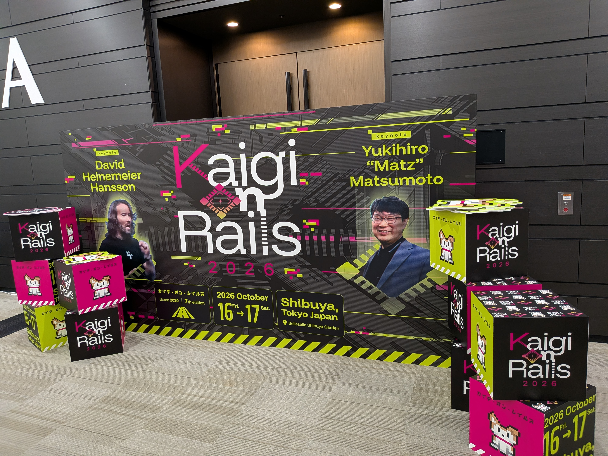

+++
title = "Kaigi on Rails 2026に参加しました！"
date = 2026-10-18

[taxonomies]
tags = ["Ruby", "Rails", "conference", "Kaigi on Rails"]

[extra]
og_image = "ogp.png"
+++

10/16(金)、10/17(土)に開催された[Kaigi on Rails 2026](https://kaigionrails.org/2026/)に参加しました！  
今回の会場は[ベルサール渋谷ガーデン](https://www.bellesalle.co.jp/shisetsu/shibuya/bs_shibuyagarden/)でした。

今年のKeynoteはDHHとMatzでした。RailsとRubyの生みの親のKeynoteを同時に聴けるなんてめったにない機会なので、開催前からずっと楽しみにしていました！  

Day1のDHHのKeynoteでは主にAIの話をされていました。最後の方では、「コンクリートで時間をかけてしっかりしたものを作るより、play-doh(粘土)ですぐに作って、気に入らなければ作り直す。専門家よりも初心者の方が多くの可能性を見つけられる。」というようなことを仰られていたのが印象的でした。  
Day2のMatzのKeynoteでもAIの話をされていて、AIによって開発速度が上がった一方でCコンパイラのビルド待ちがボトルネックになった、という趣旨の話をされていました。そこで、試行錯誤をしたい時はCRubyを使い、仕様が決まってからSpinelでコンパイルするのがいいんじゃないかという話が面白かったです。Lispはこのようなことができる言語だったみたいです。  

プログラミング言語やフレームワーク開発でAIの使用を禁止するというニュースをいくつか見たので、それとは対照的にお二人ともAIをどんどん活用されているのが面白いと思いました。

## 特に印象に残ったセッション

今年は特に印象に残ったセッションが多かったので、どのセッションについて感想を書こうかかなり悩みました！  

### Herb in Rails 8.2: Your ERB views, now HTML-aware

[スライド](https://speakerdeck.com/marcoroth/herb-in-rails-8-dot-2-your-erb-views-now-html-aware-at-kaigi-on-rails-2026-tokyo-japan)

最近Hotwireを触るようになり、気に入っていたので、それに関連するこの発表を楽しみにしていました。 内容が難しかったので、技術的な詳細はあまり理解できませんでしたが、Hotwireの動きをさらにリッチにでき、ERBをさらに綺麗に書けるようになる印象を受けました。  

- HerbエンジンがRails 8.2に導入されることになった
- HerbはHTMLとRubyをまとめて解析させるテンプレート言語・ツールチェーン
- Rails 8.2では以下が導入される
  - Herbが`*.html.erb`ファイルのデフォルト処理エンジンになる
  - `bin/rails herb:check`の追加でHTML + ERBテンプレートに問題がないかチェックできる
  - 68個の新しいLinterルール
- ReActionView
  - Hotwireには細かいリアクティビティが足りていない
  - HerbがERBのどの値がHTMLのどこに出力されるかを把握して、その場所をSlotとして管理するため、DOM全体ではなくて必要な部分だけ更新できる

発表中はHerbについての一部分しか理解できていなかったのですが、その時点でも使いたいと思うくらいワクワクする発表でした！  
スライドが公開されてから、AIに質問しながら理解を進めました。ERBの書き方を大きく変えずに、今よりもリアクティブなUIを実現する。その土台になるのがHerbだと理解して、より使ってみたくなりました。  
近々自作サービスを作り始める予定なので、さっそくHerbを使いたいと思いました。Rails 8.2がリリースされるのが楽しみです😃

### How to Design Configuration for Rails Applications

[スライド](https://speakerdeck.com/willnet/how-to-design-configuration-for-rails-applications)

まず、初めてタイトルを見た時に「設定についての設計は考えたことがないなー」と思いました！  
考えたことがなかったので、どんな内容が発表されるのかワクワクしていました！

- 設定の定義
  - ロジックを変えずにアプリケーションの振る舞いを変更するもの
- 設定の中心的な考え方
  - まとめる
  - 確認しやすい形にする
- 設定を3つの役割に分解
  - 起点: 設定値が直接定義される場所 (`.env`, `.yaml`, Credentialsなど)
  - 中継点: アプリケーションで扱える形に受け渡す仕組み (`ENV[]`, `config_for`など)
  - 終点: アプリケーションコードが参照する窓口
  - 必ず3つに分けられている必要はない。定数に直接値を書く場合は1箇所で3つの役割を担うことになる
- まとめる
  - 起点と中継点については統一的にまとめるというよりも、設定に関するものの数をなるべく減らす
  - 終点で統一的に扱えるようにまとめる
  - それぞれ具体例があるので頭に入ってきやすかった
- 確認しやすい形にする
  - 設定値が意図した値になっているかを確認するのはとても難しい
  - 意図していない値になった時にすぐ気付けるようにしたい
  - 終点をクラスに書くとテストがしやすくなる

特に最後の「終点をクラスに書いてテストをしやすくする」というのがかなり印象に残りました。そもそも設定値をテストするという考え方がなかったので、この方法を使えばテストがしやすくなり、安全に設定値を扱えるのが良いと思いました！

### Web Framework Benchmark Battle 2026, Any%

[スライド](https://speakerdeck.com/a_matsuda/web-framework-benchmark-battle-2026-any-percent)

途中で「カンファレンスがエコシステムを駆動するようになってもいいんじゃないか」ということを話されていたのが印象的でした。  
「もっとKaigi on Railsのためにコードを書いてくる、という雰囲気になって欲しい。」と言われていた気がします。今年はMarcoさんや、松田さん、RosaさんのようにRails関連の内部の話をされているセッションが複数あり、技術的な詳細は理解できなかったのですが、すごくワクワクする内容でした。なので、そういったセッションが増えれば嬉しいと思いました！  

少し話がそれますが、RubyKaigi 2026に参加した後に自分がRubyKaigiを好きな理由の一つは「問いを持ち帰れること」だと気付きました。セッションの内容を理解しきれなくても、参加前とはRubyを見る目が少し変わる感覚がありました。たぶんそれは、セッションの内容を見たり、作者の顔を見たことでRubyを触る際に「この技術ってどうやって動いてるんだろう？」とか「あのセッションで話していた技術ってどう動いてるんだろう？」という問いが生まれたからだと思います。  

「もっとKaigi on Railsのためにコードを書いてくる、という雰囲気になって欲しい」という松田さんの言葉を、自分はRubyKaigiのようにエコシステムそのものの開発に関する発表が増え、カンファレンスがRailsの進化を引っ張る存在になってほしい、という意味だと受け取りました。そうなれば、RubyKaigiに参加することで感じていた「問いを持ち帰る」という楽しみを、Kaigi on Railsでももっと味わえる気がしました。  

今年のKaigi on Railsではまさにそういった発表が多かったと思うので、自分の中で「ReActionViewはどうやって動いてるんだろう」「Solid Queueってどうやって動いてるんだろう」「今後RailsをSpinelでビルドできるようにする際にはどういった箇所が問題になるんだろう」という疑問がたくさん湧いてきて、Rails内部への興味が以前より深まった気がします。

## さいごに

当初は途中で休憩は入れるつもりだったのですが、気になるセッションが多すぎて2日間とも全時間枠のセッションを観ました。  
今回気付いたのは、「内容は分からないけどワクワクする技術だな」と感じたセッションほど、カンファレンスが終わった後も調べているということでした。これが本文中でも書いた「カンファレンスに参加して問いを持ち帰ることが好き」ということかなーと思いました。  

懇親会では、話したことがない方ともたくさん技術の話ができたことが嬉しかったです。個人的には懇親会の会場が今回のように少しだけ狭めの方が、話したことがない方にも話しかけやすいと感じました。物理的な距離が近くなるからかな？  
今回はKeynoteがDHHとMatzということが本当にすごかったですし、その他のセッションも個人的に興味がある領域の話ばかりだったので本当に大満足でした！  
今年も最高なイベントを開催してくださった運営の皆様、登壇者の皆様、会場でお話してくださった皆様ありがとうございました〜！！
